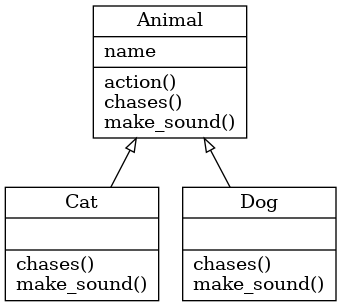

# Classes

---

layout: false

## Paradigms of programming

* Procedure Oriented Programming
* Object Oriented Programming
* Functional Programming
* Logic Programming
* Event Driven Programming
* Aspect Oriented Programming
* etc.

---

## Procedure Oriented Programming

* program is a sequence of instructions
* data is separate from functions
* functions operate on data

~~~python
def print_book(book_data):
    title, author, year = book_data
    print(f"Title: {title}")
    print(f"Author: {author}")
    print(f"Publication Year: {year}")
~~~

~~~
>>> book_data = ("Python Essential Reference", "David Beazley", 2009)
>>> print_book(book_data)
Title: Python Essential Reference
Author: David Beazley
Publication Year: 2009

~~~

---

## Object oriented programming

* classes are used to make up a program
* functions and data a unit: an object
* an object has data attributes and methods
* methods are functions that operate on its data
* enables reuse of code

* Everything in Python is an *object*, and almost everything has attributes
(data) and methods (functions for manipulating data)*

---

## Objects and Classes

### Class - blueprint for creation of an object

~~~python
class Book:
    def __init__(self, title, author, year)
        self.title = title
        self.author = author
        self.year = year

    def __str__(self):
        return \
f"""
Title: {self.title}
Author: {self.author}
Publication Year: {self.year}
"""
~~~

~~~
>>> book = Book("Python Essential Reference", "David Beazley", 2009)
>>> print(book)

Title: Python Essential Reference
Author: David Beazley
Publication Year: 2009

~~~

* `Book` is the recipe
* `book` is the created object: an instance of the class Book

### Class definition in Python

* the `class` keyword
* the name of the class + ":" (CamelCase by convention)
* the body of the class definition is indented
* the body contains attributes and methods (functions) of the class

~~~
class ClassName:
    ...
~~~

### Special methods in Python classes

* special methods have leading and trailing double underscores
* `__init__` initializes an object
* called after the object is created
* `__str__` returns a string representation of an object

### What is `self`?

* In the constructor init refers to newly created object
* In ordinary class methods it refers to the object for this method is called

---

### Using objects in a program

* define class

~~~
class Person:
    def __init__(self, first_name, last_name):
        self.first_name = first_name
        self.last_name = last_name

    def whoami(self):
        return f"My name is {self.last_name}, {self.first_name} {self.last_name}"
~~~

* creating an **instance** of an object

~~~python
p = Person("Adam", "Smith")
~~~

---

* accessing instance attributes

~~~
print(p.first_name) #Adam
~~~

* setting instance attributes

~~~
p.first_name = "John"
~~~

* calling instance methods in a program

~~~python
p.whoami() #My name is Smith, John Smith
~~~

---

## Instance attributes vs Class attributes

~~~
class Person:
    number = 0
    def __init__(self, first_name, last_name):
        self.first_name = first_name
        self.last_name = last_name

    def whoami(self):
        return f"My name is {self.last_name}, {self.first_name} {self.last_name}"
~~~

* `number` is a class attribute
* class attributes are shared by instances
* `first_name` and `last_name` are instance attributes
* instance attributes are unique to each instance

---

## Special methods and overloading

* constructor

~~~
p = ClassName() # after creation calls p.__init__()
~~~

* official string representation

~~~
repr(p) # calls p.__repr__()
~~~

* informal string representation

~~~
str(p) # calls p.__str__()
~~~

* getting attribute

~~~
p.attr # calls p._getattribute__('attr')
~~~

---

* setting attribute

~~~
p.attr  = value # calls p._setattribute__('attr', value)
~~~

* getting list of attributes

~~~
dir(p) # calls x.__dir__()
~~~

* overloading binary operators

~~~
p._add__(self, other) # addition, +
p._sub__(self, other) # subtraction, -
p._mul__(self, other) # multiplication, *
p._truediv__(self, other) # division, /
p._floordiv__(self, other) # floor division, //
~~~

---

## Class inheritance

* Making derived class from base class:

~~~
class DerivedClassName(BaseClass): #inheriting from one base class
    ...
~~~

~~~
class DerivedClassName(BaseClass1, BaseClass2): #inheriting from multiple base classes
    ...
~~~

* All methods ar virutal, i.e. overriding of methods is an intrinsic property
  of Python

* Private attributes are not inherited

* Relationship between derived ans base classes

~~~
issubclass(DerivedClass, BaseClass) #True or False
~~~

* Relationship between instance and class

~~~
isinstance(Object, Class) # True or False
~~~

---

### Simple example of parent (base) and child (derived) classes

~~~python
>>> class Parent:
...    def __init__(self):
...        print("Base constructor")
...
...    def base_method(self):
...        print('Calling base method')

>>> class Child(Parent):
...     def __init__(self):
...         print("Derived constructor")
...
...     def derived_method(self):
...         print('Calling derived method')

~~~
~~~
>>> c = Child()
Derived constructor
>>> c.base_method()
Calling base method
>>> c.derived_method()
Calling derived method
>>>
~~~

---

### When to use inheritance?

* to avoid replication of code (same attributes and methods in different
  classes)

* to take advantages of existing Python classes

* when similar if statements are repeated throughout code

~~~
import moduleName
class DerivedClass(moduleName.BaseClass):
    ...
    # override/add any functions here.
~~~

---

### Example employee class

~~~python
class Person:
    number = 0
    def __init__(self, first_name, last_name):
        self.first_name = first_name
        self.last_name = last_name

    def whoami(self):
        return f"My name is {self.last_name}, {self.first_name} {self.last_name}"

class Employee(Person):
   def __init__(self, given_name, surname, salary):
       super().__init__(given_name, surname)
       self.salary = salary

   def show_wage(self):
       return f"{self.whoami()}, and I earn {self.salary} kr"
~~~

~~~
>>> e = Employee('John', 'Doe', 30000)
>>> print(e.show_wage())
My name is Doe, John Doe, and I earn 30000

~~~

---

### Replacing repeated if-statements with inheritance

~~~python
>>> def action(animal, name):
... 
...     print(name, 'is a', animal)
... 
...     if animal == 'Cat':
...         print(name, "says 'Meow'!")
...     elif animal == 'Dog':
...         print(name, "says 'Bow-wow!'")
...     else:
...         print("Don't know what", name, "sounds like")
... 
... 
...     if animal == 'Cat':
...         print(name, "chases mouse")
...     elif animal == 'Dog':
...         print(name, "chases cat")

...     else:
...         print("Don't know what", name, "chases")

~~~

Consider adding more animals and more behaviours - 
this pattern becomes difficult to maintain in larger codes

~~~
>>> action('Cat', 'Felix')
Felix is a Cat
Felix says 'Meow'!
Felix chases mouse

~~~

---

~~~
>>> class Animal:
...     def __init__(self, name):
...         self.name = name
... 
...     def action(self):
...         print(self.name, 'is a', self.__class__.__name__)
...         self.make_sound()
...         self.chase()
... 
...     def make_sound(self):
...         print("Don't know what", self.name, "sounds like")
... 
...     def chase(self):
...         print("Don't know what", self.name, "chases")

~~~
~~~python
>>> animal = Animal('Horse')
>>> animal.action()
Horse is a Animal
Don't know what Horse sounds like
Don't know what Horse chases

~~~
---
~~~
>>> class Dog(Animal):
...     def make_sound(self):
...         print(self.name, "says 'Bow-wow!'")
... 
...     def chase(self):
...         print(self.name, "chases cat")

~~~
~~~
>>> class Cat(Animal):
...     def make_sound(self):
...         print(self.name, "says 'Meow'!")
... 
...     def chase(self):
...         print(self.name, "chases mouse")

~~~
~~~python
>>> cat = Cat('Felix')
>>> cat.action()
Felix is a Cat
Felix says 'Meow'!
Felix chases mouse

~~~

---

## Class diagrams

Are often used to illustrate dependencies between classes

* each class is represented by a box
* each box is divided name, attributes, methods
* arrows indicate inheritance relationships

---

## Static methods

Static methods are ordinary functions, living in the class namespace. They
might as well be defined outside the class, except that they are now called 
with a class name prefix. They do not depend on an instance, and do not have a
`self` parameter.

Static methods are defined with the `@staticmethod` decorator

~~~
>>> class A:
...    def instance_method(self):
...        print("In instance_method")
...
...    @staticmethod
...    def static_method():
...        print("In static method")

~~~

~~~
>>> A().instance_method()
In instance_method
>>> A.static_method()
In static method

~~~

---

## Class methods

Class methods are often used as alternative constructors

~~~
class Dog:

    def __init__(self, breed, name):
        self.breed = breed

    @classmethod
    def snoopy(cls):
        return cls('Beagle', 'Snoopy')

dog = Dog.snoopy()
print(dog.breed, dog.name)

~~~
